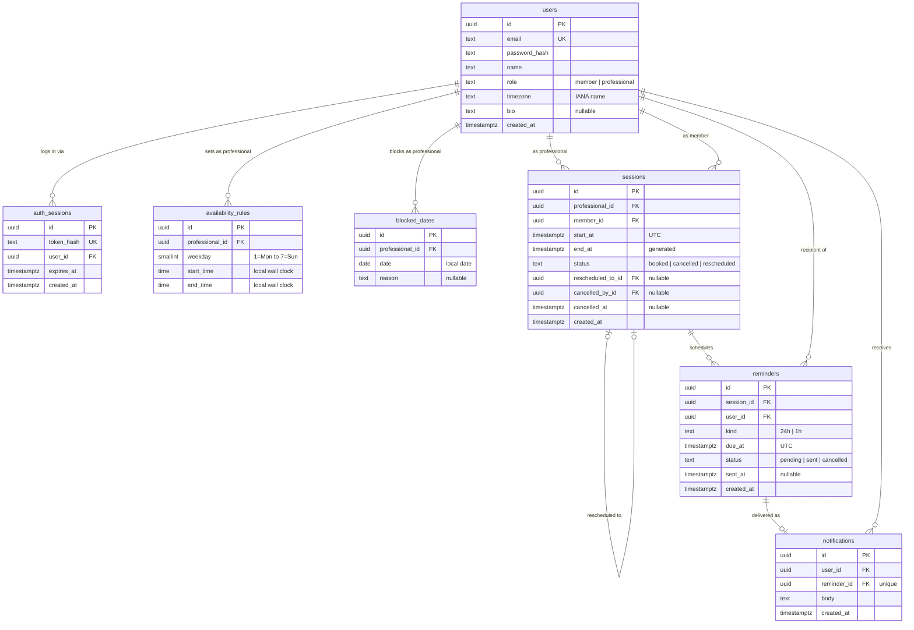

# Session Booking with Reminders

## Data model

All instants are stored as `timestamptz` in UTC. Timezones are applied in exactly two places: generating slots from availability rules, and rendering times for a user.

### Constraints that carry the business rules

| Table | Constraint | Guarantees |
|---|---|---|
| `sessions` | `end_at` generated as `start_at + 50 minutes` | Session length cannot drift |
| `sessions` | exclusion on `(professional_id, tstzrange(start_at, end_at))` where booked | A slot is booked once, even under concurrent requests |
| `sessions` | exclusion on `(member_id, tstzrange(start_at, end_at))` where booked | A member never holds overlapping sessions, even with different professionals |
| `sessions` | check `member_id <> professional_id` | No self-booking |
| `reminders` | unique on `(session_id, user_id, kind)` | One reminder of each kind per recipient per session |
| `reminders` | partial index on `due_at` where pending | The delivery poller scans only what is due |
| `notifications` | unique on `reminder_id` | A reminder is delivered at most once, even if the poller retries |
| `availability_rules` | unique on `(professional_id, weekday)`, check `start_time < end_time` | One working-hours range per weekday |
| `users` | unique on lower-cased `email` | Case-insensitive login |

### How the tables are used

- **Availability rules hold wall-clock times**, not instants, interpreted in the professional's timezone at slot-generation time. Monday 09:00 still means 09:00 after a daylight saving change.
- **Past versus upcoming** is derived from `end_at` against the current time. No status changes when a session ends.
- **Rescheduling is one transaction.** The old session is marked `rescheduled` and linked to its replacement, the new session is inserted, and reminders are rewritten. A constraint failure rolls back everything and the original stands.
- **Reminders are marked `cancelled`, not deleted**, so the record of what was and was not delivered survives.
- **`notifications.body`** is rendered at delivery time with the session time formatted in the recipient's timezone.
- **`blocked_dates`** exists only for the optional block-off-dates feature.
